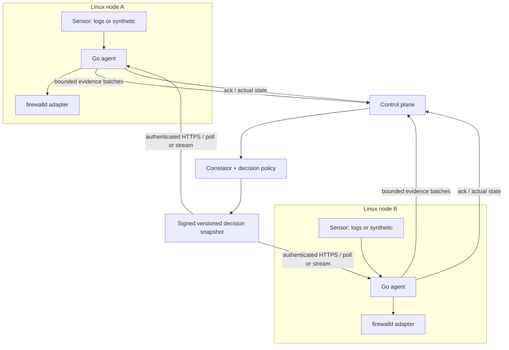

# Fleetguard architecture (draft)

**Status:** design proposal, not implemented. **Target:** small, reproducible homelab POC. **First enforcement backend:** firewalld D-Bus.

## Problem

Conventional configuration management is too slow for active incident response across thousands of Linux servers. Independent hosts can each observe a weak signal; correlating *credible, independent* observations can justify faster defense without waiting for an Ansible run.

Fleetguard separates **observation**, **decision**, and **enforcement**. It is not a DDoS mitigation appliance, IDS replacement, or host compromise remediation tool.

## Goals

- Lightweight Go agent; one central Go service; deterministic, testable end-to-end flow.
- Fleet-wide correlation with service-aware, short-lived bans and local autonomous response for high-confidence evidence.
- Work with existing firewalld zones, rules, Docker forwarding, and protocol-specific exceptions **without overwriting them**.
- Authenticated, encrypted communication over ordinary HTTPS, optionally through Tailscale.
- Signed decisions with local limits protecting management and protocol-critical traffic.
- Offline operation, durable reconciliation, visibility into actual vs desired enforcement, and one-command emergency recovery.
- Stable pluggable **sensor** and **firewall backend** interfaces, though only firewalld and mock backends ship initially.

## Non-goals for the POC

- Broad CIDR or ASN auto-blocking; automatic permanent bans; AI/LLM directly issuing firewall changes.
- Packet inspection / payload collection, unbounded per-packet telemetry, full SIEM, web UI.
- Upstream volumetric DDoS mitigation, forensic attribution, or claiming that a suspicious IP represents one malicious person.
- Multi-tenant SaaS, HA controller, Kubernetes operator, eBPF sensors, UFW, direct nftables integrations.
- Running on critical validators or Proxmox hypervisors before rigorous testing.

## System overview



### Go modules (suggested, not locked in)

```text
cmd/fleetguard-agent/
cmd/fleetguard-controller/
cmd/fleetguardctl/
internal/agent/
internal/controller/
internal/correlation/
internal/decision/
internal/transport/
internal/storage/sqlite/
internal/firewall/firewalld/
internal/firewall/mock/
internal/sensor/synthetic/
internal/sensor/firewalldlog/
pkg/protocol/
docs/
```

Prefer one module and a small set of interfaces over premature distributed services.

## Control plane

- Accepts authenticated node evidence, deduplicates, bounds rate/cardinality, stores summaries and audit events in SQLite.
- Correlates unique **independent** nodes, network sources, affected ports/services, timestamps, and quality of evidence.
- Maintains service-group scopes (e.g. `public-rpc`, `ssh`, `validator-p2p`) and node trust limits.
- Issues a **complete, versioned desired-state snapshot** with finite expiry, signed by a policy-signing key.
- Exposes policy polling and explicit acknowledgments with `received`, `validated`, `applied`, `rejected`, or `error` status.
- Keeps a durable decision log: who/what observed it, why it was promoted, scope, expiry, and revocation history.
- Separates policy signing authority from the network-facing ingest server where practical; do not store signing private keys on agents.

**No single node can self-promote a fleet-wide ban.** Count a bounded vote per unique authenticated node, and cap how much one compromised node can influence.

## Agents

1. Read locally protected config: management interfaces, explicit protected CIDRs, service roles, safety limits, trust anchors, and execution mode.
2. Collect bounded summaries from one or more sensors (mock/synthetic first; rate-limited denied-traffic logs second).
3. Maintain local temporary decisions only for **high-confidence, verifiable** evidence; cross-node correlation remains a control-plane responsibility.
4. Poll or stream signed desired state, then validate signature, monotonic revision, time bounds, destination node/service scope, and prohibited address overlap.
5. Reconcile only agent-owned firewalld objects. Report desired vs observed state, errors, and current revision.
6. Continue to reconcile from last accepted policy when offline, while expiring temporary decisions and enforcing the local maximum offline policy age.

The controller **cannot** send shell commands, replace the baseline firewall, change local protections, or request unsupported actions.

## Network event model

Aggregate rather than upload every packet. Example:

```json
{
  "schema": 1,
  "node_id": "lab-node-a",
  "event_id": "uuid",
  "observed_at": "2026-11-21T10:00:00Z",
  "window_seconds": 30,
  "source_ip": "203.0.113.42",
  "ip_family": 4,
  "service": "ssh",
  "destination_ports": [22, 2222],
  "transport": "tcp",
  "observation": "denied_connection_attempts",
  "attempts": 40,
  "distinct_ports": 2,
  "proof_level": "unverified_network_log"
}
```

Use TEST-NET and documentation addresses only in examples. **Denied SYN packets do not prove source ownership.** Treat log-only or UDP signals as low confidence; don't auto-promote them to global bans. More reliable proof may include SSH authentication failures attributable to an established connection or application-layer 4xx/abuse signals.

Privacy: keep minimal source IP + service metadata, cap retention and cardinality, avoid sensitive payloads, honor data protection requirements before wider rollout.

## Signed desired-state model

One snapshot per scope/revision is simpler to replay and recover than unreliable imperative `block`/`unblock` messages.

```json
{
  "schema": 1,
  "revision": 42,
  "issued_at": "2026-11-21T10:00:00Z",
  "expires_at": "2026-11-21T10:05:00Z",
  "audience": {"service_group": "public-rpc"},
  "decisions": [{
    "id": "decision-uuid",
    "source": "203.0.113.42/32",
    "action": "drop",
    "transport": "tcp",
    "destination_ports": [8899],
    "expires_at": "2026-11-21T10:03:00Z",
    "reason_code": "verified_multi_node_abuse"
  }],
  "key_id": "lab-policy-key-1",
  "signature": "<base64 detached Ed25519 signature over canonical payload>"
}
```

Specify and test canonical byte serialization (or sign an exact encoded payload) **before implementation**. This is a wire-format sketch, not a compatible protocol yet. Support IPv6 /128 as a planned follow-up.

Never trust remote time unconditionally: validate clock skew, TTL bounds, signed expiry, and local offline age. A rejected snapshot must not overwrite the last valid one.

## Firewalld adapter

- Detect active `FirewallBackend` and firewalld version/capabilities; **nftables is a common backend, not guaranteed**.
- Connect via D-Bus instead of launching `firewall-cmd` per address. Use a dedicated named set / agent-owned rule objects; never flush, reload, or rewrite unrelated zones.
- Separate global high-confidence and local temporary decisions internally, but expose only safe effective decisions to the backend.
- Validate exact rule ordering for allowed management traffic, INPUT vs FORWARD, Docker-published ports, Tailscale, and existing firewalld policies. **Do not assume an `ACCEPT` in one nftables chain overrides a later `DROP` elsewhere.**
- Prefer scoped drops by service + protocol + destination port. First iteration auto-bans individual IPv4 /32 sources only.
- Set expiration in agent state; if firewalld's timed IP-set entries are used, do not assume its API will enumerate them. Reconcile after agent restart and firewalld reload.
- No privileged arbitrary commands. Minimize D-Bus permissions and isolate agent capability as possible.

Relevant upstream docs:
- [firewalld D-Bus API](https://firewalld.org/documentation/man-pages/firewalld.dbus)
- [firewalld policy objects](https://firewalld.org/documentation/man-pages/firewalld.policy)
- [firewalld rich rule priorities](https://firewalld.org/documentation/man-pages/firewalld.richlanguage.html)
- [firewalld configuration / backend selection](https://firewalld.org/documentation/man-pages/firewalld.conf.html)

## Transport and identity

- Agents initiate outbound HTTPS connections. No publicly exposed agent listener is required.
- Mutual TLS or authenticated Tailscale node identity **plus strong per-node application authentication**; secure defaults must not depend on trusting the whole tailnet.
- Controller distinguishes node IDs, certificate/key identity, service groups, and revocation state. Never trust user-supplied `node_id` fields alone.
- Ed25519 policy signatures are independent of TLS. Enforce anti-replay and signing key rotation.
- Retry with jitter/backoff and bounded queues; periodic full snapshot fetch ensures eventual convergence when notifications are missed.
- Tailscale ACLs should narrowly restrict which agents can reach the controller.

## Failures and recovery

| Failure | Required behavior |
|---|---|
| Controller unavailable | No new fleet bans; retain only valid local state and unexpired accepted decisions, eventually expire |
| Firewalld reload | Revalidate / rebuild only agent-owned runtime objects |
| Agent crash/restart | Restore signed state safely; never resurrect expired bans |
| Bad/unsigned/stale snapshot | Reject, retain last valid state within TTL, alert |
| Management address proposed for block | Reject locally, alert; never try to apply |
| Clock skew / incompatible backend | Fail closed *for new dynamic enforcement*, not for baseline host connectivity |
| Queue overload | Drop/sample telemetry with a visible counter; bound memory |
| Emergency recovery | Offline local command removes only agent-managed temporary rules |

## Configuration

Local file (owned by root; remote cannot mutate): mode (`observe` default), protected CIDRs/interfaces, allowed scopes, max TTL, maximum entries, default policy, backend, and public signing keys. Configuration changes require deliberate local deployment, separate from threat intel distribution.

## Scaling direction (after POC)

Periodic batches and server-side aggregation, node/group-specific snapshots, bounded event retention, incremental hints + full snapshots, load shedding, multiple controllers, and measuring fanout to 1,000–10,000 agents. A message broker is **not** a POC prerequisite.

## Open decisions

1. Effective firewalld representation for drops that must cover both host INPUT and forwarded Docker traffic without breaking existing policies.
2. Whether service-scoped ipsets + rich rules or policy objects are best for supported firewalld versions.
3. Proof-level taxonomy for local automatic action and correlated fleet enforcement.
4. Trusted enrollment/revocation and key rotation UX.
5. Audit history / privacy retention defaults.

See [threat model](threat-model.md), [lab acceptance plan](homelab-poc.md), and [firewalld ADR](adr/0001-firewalld-first.md).
